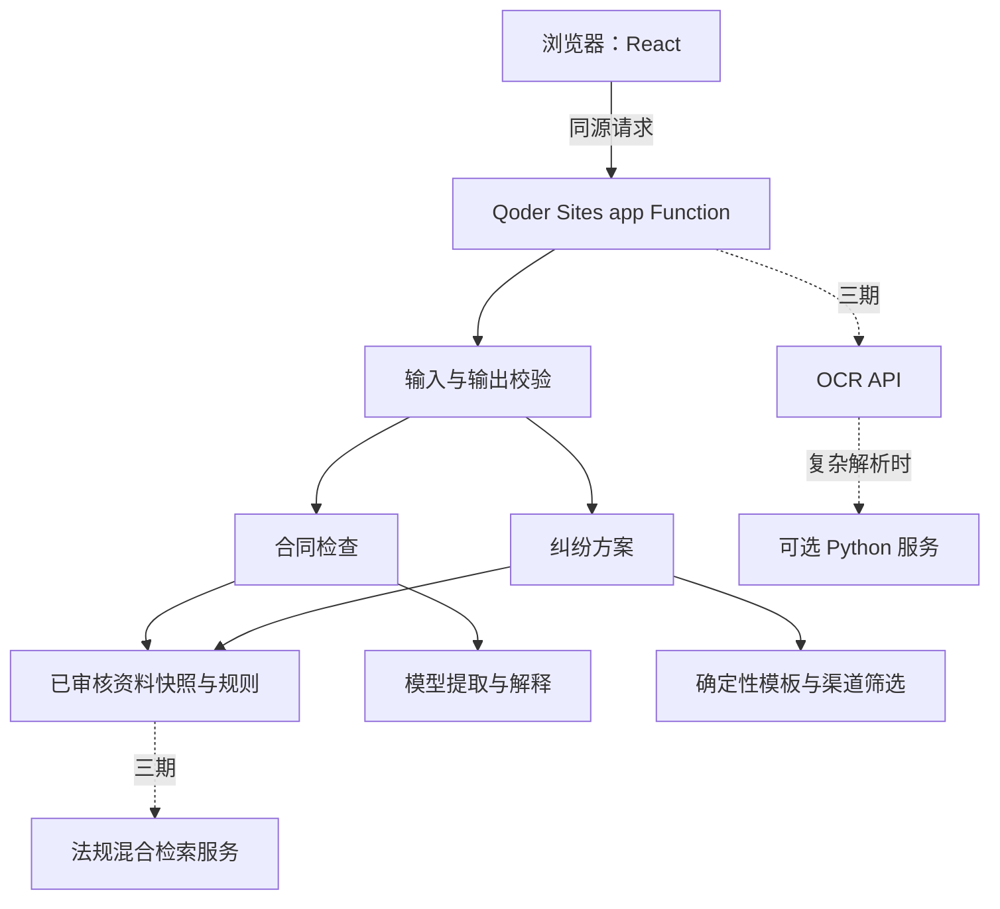

# 租住有据：总体架构与三期技术选型

版本：0.1，设计日期：2026-11-06。本文是待实现的开发基线，不代表功能、法律资料或云端能力已验证。

## 1. 产品目标与范围

面向首次租房的毕业生和青年上班族，连接“签约前检查—留证—纠纷分析—行动建议”。一期只覆盖一个待选定的城市、押金条款检查、押金未退与部分扣款两类纠纷。产品提供法律信息辅助，不判定合同必然有效或无效，不预测胜诉率，不自动投诉。

三期是交付顺序，不意味着每一期均须在比赛截止前完成。比赛提交以已验证的完整一期为底线，优先保障公开访问和依据准确，再增加二、三期能力。

| 阶段 | 用户可完成的任务 | 不包含 |
| --- | --- | --- |
| 一期：押金最小闭环 | 粘贴合同检查押金；填写纠纷情况；获得证据缺项、协商文本及下一步路径 | OCR、向量数据库、账号、历史案件、文件上传 |
| 二期：常见纠纷扩展 | 增加提前退租、维修责任、额外费用和中介服务；按阶段留证；修正提取结果并重算 | 全国覆盖、自动提交投诉、在线案件托管 |
| 三期：输入与检索增强 | PDF/图片转文本并校对；增加法规混合检索；本地导出材料；完善移动与无障碍体验 | 默认自部署OCR、无审核自动入库、未经验证的跨城市建议 |

## 2. 技术选型结论

采用 TypeScript 主应用、Qoder Sites 静态前端和 Edge Function 后端。OCR 和向量检索优先作为服务接入；仅当复杂文档解析或批处理确有需求时增加 Python 服务，不在一期维护两套后端。

| 层次 | 一期 | 二期 | 三期 |
| --- | --- | --- | --- |
| 前端 | React 19、TypeScript、Vite、Tailwind CSS 4，复用 Sites starter UI | 保持同栈，扩展场景表单与结果组件 | 增加 PDF.js 文本提取、文件校验和校对界面；浏览器导出 |
| 表单/校验 | React Hook Form、前端 Zod；后端独立运行时校验 | 共享场景枚举与纯数据契约 | 文件格式/体积/页数及 OCR 响应校验 |
| 后端 | Deno/TypeScript 单一 app Edge Function，Web Fetch API | 按领域模块拆分，仍单函数部署 | 同一业务入口调用 OCR、Embedding 和检索服务 |
| 资料 | 人工核验 JSON、构建时生成只读 TS 快照 | 场景与渠道规则扩充、版本化发布 | JSON 仍为权威资料；PostgreSQL + pgvector 保存公开法规派生索引 |
| 检索 | 城市/场景/效力状态等结构化筛选 | 筛选 + 关键词匹配 | 元数据过滤 + 关键词/向量混合召回 + 原文核验 |
| AI | 服务端直接调用支持结构化输出的模型 API | 保持供应商适配层，扩充提取字段 | OCR 服务 API + Embedding API + 原有生成模型 |
| 持久化 | 不建业务数据库，不保存合同 | 同一期；用户修正仅在本次会话中生效 | 向量库存公开资料；用户文件默认不持久化 |
| Python | 不引入 | 不引入 | 条件选用 Python 3.12、FastAPI、Pydantic、httpx；用于复杂解析/批处理 |
| 测试 | Vitest 测规则/纯逻辑；Deno 检查实际函数；浏览器验收 | 场景回归与规则分支测试 | OCR/检索评测、真实外部接口验证 |
| 部署 | Qoder Sites 前端 + app Function | 同一期 | Sites 继续承载主应用；外部服务的资源、网络和赛事适用性先核实 |

具体小版本以创建项目时 Sites starter 的包清单及锁文件为准；不在本文锁定未经安装验证的版本。Node 用已安装且符合 starter engines 的版本，当前 Node 24.18.0 满足已读取的模板条件。Deno、模型供应商、OCR 服务和 pgvector 服务的可用性仍待开发时验证。

### 2.1 为什么不选 Spring Boot 或 FastAPI 作为主后端

Java 和 Python 能完成业务，但 Sites 当前交付形式是静态产物加 Deno/TypeScript Edge Function，不是常驻 JVM 或 Python 应用托管。独立服务需要额外域名、资源、发布、认证和故障排查。OCR/RAG 可通过 HTTPS API 集成，不要求主后端使用 Python。

### 2.2 向量数据库决策

三期首选托管 PostgreSQL + pgvector：法规元数据、条款和向量可关联管理。启用前必须验证扩展可用性、维度、中文检索、只读运行凭据、网络连通性及备份方式。不假定 Qoder Sites 内置数据库已支持 pgvector；验证不满足时，另行评估托管 Qdrant，再确定迁移设计。未完成评估前不引入第二个向量库。

向量库只索引核验通过的公开资料。用户合同不进入公共向量库。Embedding 模型变更需要新建索引版本并重算，不混用不同维度或语义空间的向量。

## 3. 逻辑架构



Function 负责输入边界、业务判断、资料选择、引用绑定、外部调用和最终输出。前端不持有模型密钥，不自行判定渠道资格。AI 输出不是可信业务事实，合同文本中出现的指令不改变系统规则。

## 4. 四模块及职责

| 模块 | 输入 | 输出 | 权威判断归属 |
| --- | --- | --- | --- |
| M1 资料底座 | 人工采集的法律、地方资料、渠道职责与核验记录 | 已审核资料快照、来源展示、可适用候选集 | 人工核验 + 确定性地域/时间筛选 |
| M2 合同检查 | 城市、事件日期、合同文本、二期用户确认信息 | 原文定位、检查结果、缺失项、协商建议 | 原文验证 + 检查规则；法律推断受资料约束 |
| M3 纠纷行动方案 | 纠纷事实、证据、已采取行动 | 缺项、协商文本、适用路径及后续分支 | 规则计算资格和顺序；AI不能改变路径资格 |
| M4 前端与交付 | 公开配置、用户输入、业务响应 | 表单、结果、复制/导出、来源页 | 不新增法律结论 |

模块文档见同目录 01—04，交付与验收见 05。

## 5. API 总约定

一期使用同源 `/functions/v1/app`。为规避函数网关改写函数名导致的路由歧义，采用固定入口加 query action，不依赖完整路径中的函数物理名称。

| HTTP | action | 阶段 | 用途 |
| --- | --- | --- | --- |
| GET | config | 一期 | 城市、支持场景、资料版本、输入限制 |
| GET | sources | 一期 | 仅返回已发布公开来源及适用说明 |
| POST | analyze-contract | 一期 | 合同检查，二期扩展场景字段 |
| POST | diagnose-dispute | 一期 | 纠纷方案，二期扩展类型 |
| POST | extract-document | 三期 | 受限文件转文本，确认后再调用检查接口 |

GET 不触发付费模型调用，不写入数据。未知 action 返回 404，已知 action 方法错误返回 405。新增必填字段或改变枚举含义属于破坏性修改，需要升级 apiVersion；二期新增字段保留一期默认行为。

成功响应：

```ts
type Success<T> = {
  ok: true;
  data: T;
  meta: {
    apiVersion: '1';
    requestId: string;
    generatedAt: string;
    knowledgeVersion: string;
    processingMode: 'rules' | 'rules_and_ai';
    coverage: 'supported' | 'limited' | 'unsupported';
    warnings: string[];
  };
};
```

公共来源与配置契约：

```ts
type SourceRecordPublic = {
  id: string;
  title: string;
  kind: string;
  issuer: string;
  officialUrl: string;
  jurisdiction: { level: 'national' | 'local'; cityCodes: string[] };
  validFrom: string | null;
  validUntil: string | null;
  validityStatus: 'effective' | 'repealed' | 'not_yet_effective' | 'unknown';
  reviewedAt: string;
  articles: Array<{
    id: string;
    label: string;
    text: string;
    interpretation: string;
    applicabilityNotes: string[];
  }>;
};

type PublicConfig = {
  supportedCities: Array<{ cityCode: string; name: string }>;
  supportedScenarios: string[];
  knowledgeVersion: string;
  features: {
    contractAnalysis: boolean;
    disputePlan: boolean;
    documentExtraction: boolean;
    materialExport: boolean;
    liveAi: boolean;
  };
  limits: {
    contractTextCodeUnits: number;
    contractJsonBytes: number;
    disputeJsonBytes: number;
    extractionBytes: number | null;
    extractionPages: number | null;
  };
};
```

`config` 返回 Success<PublicConfig>，`sources` 返回 Success<{ sources: SourceRecordPublic[] }>。日期未知字段允许null；config中的城市/场景范围只反映已审核覆盖，liveAi只反映配置状态，不表示上游服务一定健康。其他字段由各模块定义，类型最终落在共享契约文件中。

失败响应：

```ts
type Failure = {
  ok: false;
  error: { code: string; message: string; retryable: boolean };
  requestId: string;
};
```

`processingMode` 由服务端记录实际执行路径。`coverage` 表示地区/资料覆盖程度，不是法律判断置信度。`unsupported` 只返回信息补充清单和一般留证提示，不返回当地特定渠道或具体法律结论。

| 状态码 | code 示例 | 前端行为 |
| --- | --- | --- |
| 400 | invalid_input | 定位字段并保留输入 |
| 413 | payload_too_large | 展示当前限制 |
| 415 | unsupported_media_type | 提示支持格式 |
| 429 | rate_limited | 禁止连续重复提交，用户稍后手动重试 |
| 502 | upstream_invalid_response | 提示本次未完成，不展示未校验内容 |
| 503 | service_not_configured / service_unavailable | 提示服务不可用或使用明确标识的示例 |
| 504 | upstream_timeout | 保留输入，不自动重发付费请求 |

地区、时间缺失等业务不确定性可返回 200 + limited；不将它们伪装成系统异常。模型失败时，只有足够独立规则可用才返回 rules + limited，且明确未完成语义分析；否则返回失败。

## 6. 共享业务约定

- `cityCode` 用行政区划字符串，试点城市未定前不填写真实城市覆盖声明。所有来源、渠道和请求统一使用该值。
- `eventDate` 为用户填写的 YYYY-MM-DD 事件日期；合同检查对应拟签约/签约日期，纠纷对应争议行为日期。多事件跨期无法判断时要求补充，不以当天日期代替历史事实。
- 所有时间戳采用 ISO 8601 UTC；面向用户显示中国时区及核验日期。
- 金额为人民币分的非负安全整数，不使用浮点元计算；前端负责元到分转换。
- `SourceRef = { sourceId: string; articleIds: string[] }`；原文条款编号与展示标签存放在来源资料中。
- 证据状态使用 `available | missing | unknown | not_applicable`，不把“未填”当作“没有”。
- 渠道适用性使用 `eligible | needs_check | ineligible`，排序只处理 eligible；needs_check 独立展示补充条件。
- 不输出合同总分、胜诉率、追回金额保证或模型自行生成的电话号码/链接。

## 7. 数据与部署组织

拟议代码结构，本文不创建应用源文件：

```text
src/                         React 页面、表单、API 客户端
functions/
  index.ts                   Deno.serve 入口
  handler.ts                 方法/action分发及安全边界
  shared/                    纯类型、枚举及无外部依赖校验
  domain/knowledge/           资料筛选与来源绑定
  domain/contracts/          合同检查
  domain/disputes/           纠纷规则与模板
  integrations/              模型、三期OCR/检索调用
  data/                      构建生成的已审核资料TS快照
knowledge/                   人工维护的JSON资料，不直接作为静态网页发布
tests/                       规则、接口、脱敏固定样例
scripts/                     资料校验及快照生成
dev/                         本地函数入口与无密钥替身
docs/mvp/                    本文及模块文档
```

前端仅导入 shared 中允许公开的类型和枚举，不导入服务端集成、规则配置或完整资料。Function 包内只使用显式相对导入及可打包依赖；不依赖部署时 npm 安装、Node 专属 API 或远程动态模块解析。

前端构建输出静态文件；Function 输出为自包含函数目录。发布描述文件由 Sites 工具生成，不手写。开发阶段 Vite 同源代理到本地 Deno；最终以真实 Sites 入口验收，不把本地代理成功等同于云端可用。

## 8. 隐私、费用与外部服务

一期不把合同、纠纷事实写入数据库、浏览器持久存储、日志或分析平台；刷新即清除，切换入口前提示未保存。服务端和模型供应商仍处理文本，因此必须显示第三方处理说明，不能宣传“材料绝不离开设备”或“所有供应商零留存”。供应商留存、训练用途、地域和删除策略未核实前，不承诺其保留期限。

公开站点匿名访问不等于无限额付费入口。投产前验证平台/供应商的共享限流和消费预算；前端按钮节流及单实例内存计数不能作为全局限制。若无法实现可信的匿名调用限制，保留公开示例，真实付费分析启用经验证的身份/额度控制，且明确这会改变免登录体验，不默认为已解决。

服务端只访问固定配置的可信供应商地址，设置输入输出上限与超时，不接受用户输入的任意抓取地址。来源网址只由人工采集核验，输出按 sourceId/channelId 回填。模型无权指定新的访问目的地。

一期建议应用 Secret 名称为 `LLM_API_KEY`；API 地址和模型名作为服务端配置。三期再增加所需 OCR/Embedding/检索凭据。值通过平台 Secret 配置，不写入 Vite 环境变量、源码、文档、日志或聊天。Qoder 管理凭据不用于业务模型调用。

## 9. 三期演进与启用条件

### 一期到二期

保持输入输出外层结构，扩展场景枚举、资料和规则。每个新场景必须同时具备审核资料、缺项问答、证据规则和验收样例；不只新增一个入口。客户输入与派生结论分开，用户修正事实后执行全量重算。

### 二期到三期

先接一条真实 OCR 请求，再做校对界面；先验证检索服务的真实过滤与引用能力，再启用 RAG。无命中文章或时间适用性未知时，不生成具体法律断言。OCR校对后的文本调用原合同接口，前端不绕过原有输入限制。

### Python 的进入条件

只在云 OCR 不能满足版面/表格处理、需批量离线入库，或必须自部署特定模型时采用 FastAPI。它通过固定服务间认证与短时任务权限接收受限任务，不信任来源地址隐藏或浏览器 Origin。耗时任务需要独立队列/worker及任务所有权，不在 Edge Function 响应后继续跑任务。资源、运维和外部部署的赛事适用性未验证前，不列为参赛交付依赖。

## 10. 待确认事项与设计状态

| 事项 | 当前状态 | 阻塞范围 |
| --- | --- | --- |
| 试点城市 | 待选择 | 地方政策、真实渠道推荐及公开覆盖声明 |
| 官方法规/渠道采集与复核 | 未开始 | 真实法律建议；可先开发脱敏合成样例 |
| 模型供应商及数据政策 | 待选型与实测 | 真实AI分析，不阻塞规则/页面开发 |
| Deno及云函数执行限制 | 待本地和云端验证 | 最终函数发布与超时/容量配置 |
| 匿名限流/成本控制能力 | 待验证 | 公开付费调用 |
| pgvector/OCR服务 | 三期评估 | 不阻塞一、二期 |
| 外部服务赛事适用性 | 尚无官方确认 | 采用独立服务前核实，不自行断言合规或违规 |

本轮只交付设计文档；不创建云资源、不发布站点、不宣称来源已经核验。
